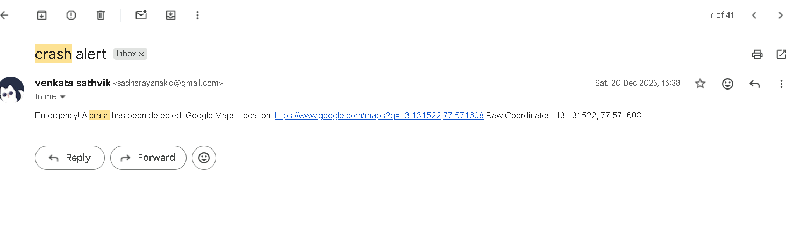
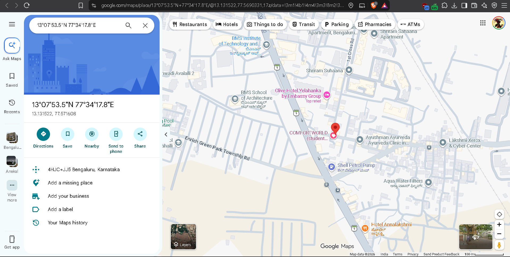
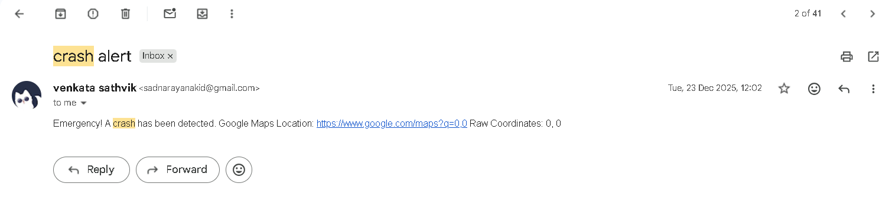

# IoT Accident Detection & Alert System

A real-time embedded tracking and accident detection system designed to monitor vehicle impact and automatically transmit location-based alerts. 

### 🛠 Hardware Architecture
* **Microcontroller:** ESP32 
* **Impact Sensor:** ADXL345 3-axis accelerometer (communicating via I2C/SPI)
* **Location Tracking:** NEO-6M GPS module (communicating via UART)

### 💻 Software & Firmware
* **Languages:** C/C++ 
* **Core Logic:** Custom I2C/UART driver logic for sensor interfacing and data parsing
* **Telemetry:** Automated webhooks via Make.com to dispatch minimal-latency alert payloads

### ⚙️ System Workflow
1. The ESP32 continuously reads the ADXL345 for G-force variations.
2. Upon crossing a hard-coded impact threshold, the system triggers a threshold alert.
3. The ESP32 parses current latitude and longitude from the NEO-6M GPS module via UART.
4. A serialized payload containing the coordinates is dispatched via a Make.com webhook to notify emergency contacts.

### 📡 System Demonstration & Results

**Live GPS Tracking & Alert (Outdoor Test):**
When a crash is detected and the GPS has a valid satellite fix, the system successfully emails a Google Maps link with the exact coordinates.

**Initial Test Run (Indoor/No GPS Fix):**
During indoor testing or before the NEO-6M module acquires a satellite lock, the system defaults to sending a `0, 0` coordinate payload to ensure the impact alert is still delivered immediately.

### 🚀 Setup & Installation
1. Clone this repository.
2. Open the project in the Arduino IDE or ESP-IDF.
3. Update the WiFi credentials and webhook URL in the main configuration file.
4. Flash the firmware to the ESP32.
